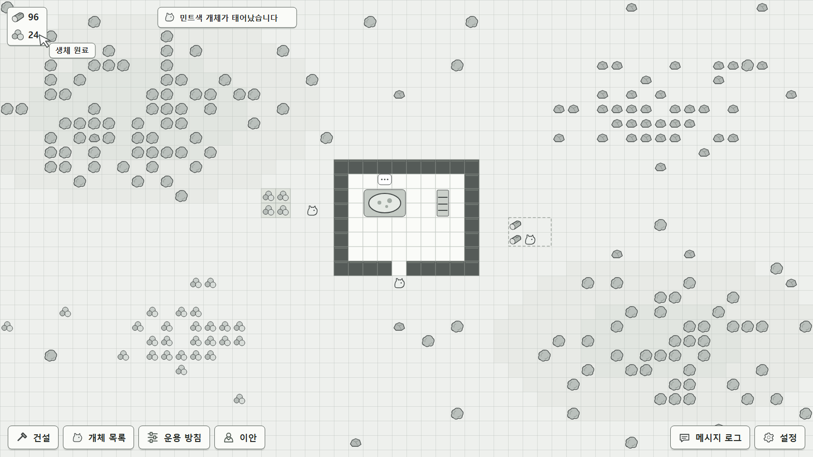

# 화면·상호작용과 생명체 표현

- 갱신일: 2026-11-26
- 상태: 행동 이해·배경설명·PC 고려 재배치·커맨더 조작 흐름 확정. 2026-11-26 UI 기본 배치 검토 완료, 상세 화면·상태 표현은 후속 작업. 모든 생명체의 머리 위 말풍선 지원 확정
- 근거: 행동 이해·PC 화면·커맨더 명령 흐름 및 관련 표현 채택에 이어 2026-11-17 주인공 클릭을 통한 방침 설정·평시 전투 참여 설정 지정.

## 확정 방향

- 연구소를 관찰하면서 생명체의 현재 행동을 알아차릴 수 있도록 한다.
- 가능한 일과 현재 상태를 이해하고 필요한 운영 지시를 내릴 수 있어야 한다.
- 배경설명을 제공해 생명체와 세계에 대한 몰입을 지원한다.
- PC 첫 출시에 맞춰 화면 배치를 재설계한다. 기존 모바일 UI와 가로·세로 대응을 새 제품의 고정 기준으로 삼지 않는다.
- 커맨더 선택 → 생명체 옆 명령 버튼 → 작업 선택 → 수준 선택 → 명령 설정의 원본은 [커맨더](../systems/commanders.md#확정한-상호작용-흐름)를 따른다.
- 전투는 관찰과 상태·결과 이해를 위한 화면으로 표현한다. 플레이어가 이동·공격·대상·후퇴 등을 지시하는 전투 조작 UI는 제공하지 않는다.
- [주인공 마스코트](characters.md)를 클릭해 운용 방침을 설정한다. 평시에 생명체별 전투 참여·작업 유지를 구분하며, 세부 화면과 일괄 선택 방식은 미정이다. 주인공의 이동·공격 직접 조작을 추가하지 않는다.
- 2026-11-17 확정한 역할에 따라 주인공 화면은 방침·개별 설정·자동 배분 위임, 커맨더 화면은 위임 범위의 작업 배분 설정을 담당한다. 기존 커맨더 명령 흐름을 유지하고 한 명령에 두 캐릭터의 순차 클릭을 요구하지 않는다.
- 조수는 초반 선택 시 전문 계통과 능력 차이를 이해할 수 있게 한다.
- 연구 항목의 효과·보너스 조건·달성 여부와 조수 연구량·보너스 기여량을 구분해 보여준다. 규칙은 [연구](../systems/research.md)를 따른다.
- 건설 예약·자재 공급·작업·완료와 진행도·대기 이유를 구분해 보여준다. 현장 우선순위와 예약 변경·취소는 [건설](../systems/construction.md)의 규칙을 따른다.
- 2026-11-17 채택한 [공급 상태 표현](../systems/logistics.md#관찰과-피드백)에 따라 배양시설의 원료 부족, 운반 개체 대기, 운반 개체의 대피로 인한 도착 지연을 구분하고, 회복시설의 사망 잔여시간·예상 회복 시간·원료 공급 상태를 함께 보여준다.
- 첫 프로토타입의 배양시설은 대피 중인 짐과 창고에서 운반할 개체를 기다리는 원료가 함께 있으면 **‘운반 개체 대기’**를 주된 이유로 보여주고, 대피 중인 원료의 수량을 함께 표시한다.
- 원료 자체가 부족하고 창고의 공급 가능한 물량도 운반을 기다린다면, 배양시설에 **‘원료 부족’**을 주된 이유로 표시하고 추가 채취량과 운반 대기량을 함께 보여준다. [공급 상태 표현](../systems/logistics.md#관찰과-피드백)
- 2026-11-17 채택한 [방과 실내 표현](../systems/rooms.md#관찰)에 따라 기본 화면에서 지붕을 숨겨 내부 활동을 관찰하고, 공간 선택 시 실내 여부와 미완성·외부 연결 이유를 보여준다.

## 첫 프로토타입의 시작 대화와 첫 지시

2026-11-25 확정. 연출형 인게임 대화(Dialogue)에서는 화면 하단에 대사창을 두고 오른쪽에는 항상 주인공의 일러스트를, 왼쪽에는 그 장면의 대화 상대를 보여준다. 두 사람 중 누가 말하는지 알아볼 수 있어야 한다. 대사창에서 대화를 주고받는 동안 게임 시간과 연구소 작업은 멈춘다.

수림 평지 중앙 터에서 주인공과 조수가 처음 만나는 대화는 튜토리얼을 꺼도 보여준다. 이 장면에서는 왼쪽에 조수가 등장한다. 대화가 끝나면 게임이 재개되고 플레이어가 조수를 선택해 첫 배양을 지시할 수 있다.

첫 배양의 단서는 조수의 휴대용 배양 도구다. 플레이어는 도구를 보고 조수를 선택해 배양을 한 번 지시한다. 조수가 근처에서 생체 원료 한 마리분을 채취해 도구에 넣는 동작을 보며 지시가 진행 중이고 탄생까지 기다리면 된다는 것을 알 수 있게 한다. 태어난 개체가 일을 이어받는 흐름은 [시작 구성](early-game.md#본편-기획의-시작-구성)을 따른다.

## 머리 위 말풍선 대사

2026-11-26 사용자 지정으로 확정. 기존 연출형 Dialogue와 별도로, 대상의 머리 위에 말풍선으로 대사를 표시할 수 있게 한다.

- **주인공·조수를 포함한 모든 생명체가 말풍선 대사를 표시할 수 있다.** 표시 기능의 지원 대상을 일부 종이나 인간 캐릭터로 제한하지 않는다.
- 일반 생명체는 말풍선을 거의 사용하지 않을 것으로 예상하지만, 기능은 사용할 수 있도록 준비한다. 모든 종에 빈번한 대사나 필수 대사 콘텐츠를 부여한다는 뜻은 아니다.
- [기존 연출형 대화](#첫-프로토타입의-시작-대화와-첫-지시)는 대사창·인물 일러스트로 보여주며, 말풍선은 이와 별개의 표시 방식이다. 기존 대화의 배치와 일시정지 규칙은 유지한다.
- [세계관 전달](narrative.md#세계관을-전달하는-방식)을 위한 대사 표시 기능으로 관리한다. 사운드 기능이나 음성 재생을 추가하는 결정이 아니다.

발생 조건·빈도·표시 시간·문구 길이, 여러 말풍선의 겹침·동시 표시, 화면 밖 대상·대상 소멸 시 처리, 연출형 대화와의 동시 표시·우선순위, 말풍선 표시 중 시간 진행과 로그 기록 여부는 미정이다. 연출형 Dialogue의 일시정지 규칙을 말풍선에 자동 적용하지 않는다. 구체 구현 시점은 후속 개발 범위에서 정한다. 2026-11-26 사용자 지정으로 말풍선 관련 데이터는 언제든 쉽게 추가할 수 있게 준비하며, 세부 구조는 [말풍선 데이터 확장 지침](../../agents/implementation.md#말풍선-데이터-확장)을 따른다.

## 첫 플레이 튜토리얼

첫 플레이 튜토리얼은 조수에게 첫 배양을 지시하는 방법을 인게임 대화로 안내하고, 조수의 휴대용 도구에서 첫 민트색 개체가 태어나면 끝난다. 플레이어는 옵션에서 튜토리얼을 켜거나 끌 수 있다. 이후에는 개체의 채취와 운반을 관찰하며 첫 건설과 추가 배양을 스스로 진행한다.

튜토리얼 대화를 읽는 동안에는 [인게임 대화의 일시정지 규칙](#첫-프로토타입의-시작-대화와-첫-지시)을 따른다. [탄생 알림](#탄생-알림과-자동-일시정지) 자체는 연구소 운영 중에 표시된다.

튜토리얼을 켜면 대화에서 안내하는 UI나 맵 대상을 강조한다. 대화가 끝난 뒤에도 플레이어는 평소처럼 다른 곳을 선택하고 조작할 수 있다. 예를 들어 첫 배양을 지시하기 전에 주변 원료를 살펴보고 돌아와도 조수의 강조가 남아 있다. 첫 배양을 지시하면 강조가 끝나고 조수가 원료를 채취하는 모습을 볼 수 있다.

테두리 표시, 주변을 어둡게 하거나 흐리는 방식, 두 방식의 조합은 플레이 테스트에서 비교한다.

## 시설 상호작용 아이콘

2026-11-25 확정. 모든 시설은 맵에서 해당 시설 위에 아이콘을 띄워 플레이어가 할 수 있는 조작을 보여준다. 플레이어의 선택을 기다리는 시설은 선택하기 전부터 필요한 조작을 아이콘으로 알린다. 아이콘에 마우스를 올리면 뜻을 짧게 확인할 수 있다. 같은 조작이나 상태에는 시설이 달라도 같은 아이콘을 쓴다.

예를 들어 [생체원료 추출기](../systems/production.md#첫-프로토타입의-추가-생산시설)를 처음 완공하면 시설 위에 재료 선택 아이콘이 뜬다. 플레이어가 추출기에서 목재나 버섯을 고르면 재료 선택 표시는 사라진다. 이후에는 선택한 재료의 운반 상태를 보고 도착을 기다릴 수 있다.

## 배양시설의 대기 이유 아이콘

2026-11-25 확정. 예약한 회차가 시작을 기다리는 동안 맵의 배양시설 위에는 현재의 주된 이유를 나타내는 아이콘 하나를 표시한다. 원료 부족, 운반 개체 대기, 운반 중, 보유 상한 대기는 색을 구별하지 않아도 모양으로 알아볼 수 있게 한다. 운반할 개체를 기다리다가 필요한 원료를 나를 개체가 일을 맡으면 운반 중 표시로 바뀐다. 플레이어는 시설을 열지 않고도 이제 도착을 기다리면 된다는 것을 확인할 수 있다.

아이콘에 마우스를 올리면 짧은 이유와 관련 수량을 보여준다. 예를 들어 더 필요한 원료 6개 중 창고의 4개가 운반을 기다리면 시설 위에는 원료 부족 아이콘이 뜨고, 마우스를 올리면 2개는 더 채취해야 하고 4개는 운반 대기 중임을 알 수 있다. 이유가 겹치거나 운반 개체가 대피할 때의 판정은 [공급 상태 표현](../systems/logistics.md#관찰과-피드백)을 따른다.

화면 밖의 배양시설에서 예약한 회차가 보유 상한 때문에 대기를 시작하면 알림을 한 번 표시한다. 같은 대기가 이어지는 동안 연구소 운영은 계속되고, 플레이어는 하던 일을 마치거나 알림을 눌러 해당 배양시설을 확인할 수 있다.

## 탄생 알림과 자동 일시정지

2026-11-24 결정에 따라 개체가 태어나면 탄생 알림만 표시하고 연구소 운영은 계속한다. 플레이어가 알림을 열기 전이나 개체를 비교하는 동안에도 개체들은 일하고, 시작 조건을 충족한 [다음 예약 회차](../systems/production.md#첫-프로토타입의-배양-예약)는 자동으로 시작된다.

첫 프로토타입에서 중앙 경고로 게임이 자동 일시정지하는 사건은 적대 생명체의 연구소 진입뿐이다. 일반 알림과 중앙 경고의 적용 기준은 [이벤트 알림 등급](../systems/events.md#이벤트-알림-등급)을 따른다.

첫 습격으로 게임이 멈추고 중앙에 알림이 뜰 때 카메라는 플레이어가 보던 곳에 머문다. 알림을 확인하거나 알림에서 습격 위치로 시점을 옮겨도 일시정지는 유지된다. 플레이어가 직접 재개하면 연구소 시간이 다시 흐르고 자동 전투가 진행된다.

## 메시지 로그

2026-11-25 확정. 플레이어가 별도로 열어 볼 수 있는 메시지 로그에 모든 이벤트 알림을 기록한다. 알림이 화면에서 사라지거나 상황이 해결된 뒤에도 당시 메시지를 다시 읽을 수 있다. 예를 들어 구조 대기 알림을 놓쳤다면 로그에서 어느 개체가 어디에서 어떤 이유로 구조를 기다렸는지 확인한다.

알림창과 메시지 로그에는 같은 **위치로 이동하기** 버튼을 사용한다. 이동 대상 오브젝트가 있으면 버튼을 눌러 맵의 시점을 그 대상으로 옮길 수 있다. 대상이 없거나 이미 사라졌으면 메시지는 그대로 읽을 수 있고, 버튼은 비활성 상태로 표시되어 클릭할 수 없다. 옅은 회색, 취소선, 마우스를 올렸을 때 강조 생략 등 구체적인 표현은 개발과 플레이 테스트에서 정한다.

## 첫 방어 후 구조 대기 알림

첫 방어에 성공한 뒤 쓰러진 개체가 있고 완공된 기본 회복시설이 없어 구조를 시작할 수 없으면, 그 개체의 위치와 회복시설이 필요하다는 이유를 일반 알림으로 한 번 보여준다. 알림이 떠도 연구소 운영과 사망까지의 시간은 계속 진행된다. 플레이어는 시설 건설을 판단할 수 있다. 사망 제한시간 안에 구조자와 옮길 자리가 확보되면 동료가 [자동으로 구조](../systems/maintenance-and-loss.md#전투-종료-후-자동-구조)한다.

## 개체 비교와 운용 목록

2026-11-24 결정에 따라 플레이어가 개체를 클릭하면 같은 종의 다른 개체와 기본 스탯·작업 역량을 쉽게 비교할 수 있다. 비교할 시점은 플레이어가 고른다. 예를 들어 운반이 밀릴 때 현재 일하는 개체를 클릭해 같은 종 가운데 운반을 맡길 개체를 살펴볼 수 있다.

별도 메뉴에서는 현재 운용 중인 개체를 목록으로 보고 필터로 원하는 개체를 찾을 수 있다. 필터의 세부 항목은 UI 기획에서 정한다.

## 예약을 받을 시설 선택

같은 작업의 예약을 받을 수 있는 시설이 두 곳 이상이고 목적지가 아직 정해지지 않았다면, 후보 시설과 각 시설의 대기 수량을 함께 보여준다. 플레이어가 고른 시설이 예약을 받는다. 재활용은 기다리는 개체 수로 표시하고, 다른 시설은 해당 작업의 예약 단위로 표시한다. 시설 화면에서 직접 예약할 때는 열어 둔 시설이 목적지다.

## 재활용 지시

- **시설에서 여러 마리 선택** — 재활용 시설을 열면 현재 연구소 안에 있는 생명체 목록에서 재활용할 개체를 여러 마리 고를 수 있다.
- **개체에서 한 마리 지정** — 연구소에서 개체를 클릭하면 그 개체 옆에 상호작용 아이콘들이 나타난다. 필요하면 같은 종과 비교한 뒤 **재활용** 아이콘을 누른다. 재활용 가능한 시설이 여러 곳이면 [시설별 대기 마릿수를 보고 보낼 곳을 고른다](#예약을-받을-시설-선택). [재활용 지시와 보유 코스트](../systems/creatures.md#배양-결과와-유니크-개체)

2026-11-25 확정. 두 경로 모두 예약 전에 선택한 개체를 보여준다. 여러 마리를 골랐다면 선택한 개체 전체를 한 번에 확인한다. 잘못 골랐으면 선택으로 돌아가 대상을 바꿀 수 있다. 플레이어가 확정하면 고른 시설의 대기열에 등록되며, 시설에서 대기 중인 개체를 확인할 수 있다.

플레이어는 **즉시 재활용**을 선택해 해당 개체가 짐을 그 자리에 내려놓고 바로 시설로 향하게 할 수 있다. **예약 취소**는 시설에서 처리를 시작하기 전까지 해당 개체에만 적용한다. [재활용 예약과 취소](../systems/creatures.md#배양-결과와-유니크-개체)

## 작업 우선순위 설정

하단의 **운용 방침**을 누르거나 맵에서 주인공을 선택하면 같은 개체별 작업표가 열린다. 플레이어는 개체별로 수행 가능한 작업의 중요도를 설정한다. 작업 종류는 왼쪽에서 오른쪽으로 배열하며, 같은 긴급도의 일 중 중요도가 높은 종류를 먼저 고르고 동률일 때 왼쪽 열을 우선한다. 예를 들어 열이 요양·치료·건설·가공 순이고 네 종류의 중요도가 같다면, 요양과 치료에 해당하는 일감이 없을 때 건설을 가공보다 먼저 살핀다. 이 배열은 동률 판정 예시이며 실제 작업 목록과 열 순서는 추후 정한다. 새 개체는 기본 작업표로 바로 일한다.

맵에서 일할 개체를 선택한 뒤, 그 개체가 수행할 수 있는 작업과 대상을 골라 한 건을 강제로 지시한다. 예를 들어 방어 후 환자가 둘이면 치료(환자 이송)를 고르고 먼저 옮길 환자를 지정한다. 지시가 내려지면 개체는 들고 있던 짐이나 환자를 그 자리에 내려놓고 즉시 지정한 대상으로 향한다. 강제 작업 중인 개체를 선택하면 **강제 작업 취소**가 나타난다. 완료하거나 취소하면 [기존 작업표로 다음 일을 고른다](../systems/work.md#강제-작업-지시).

설정이 행동에 반영되는 순서와 시점은 [작업 선택](../systems/work.md#작업-선택-순서)과 [작업 중단](../systems/work.md#작업-중단과-자기-보충)을 따른다. 운반할 원료의 목적지는 [생체 원료 배분](../systems/logistics.md#생체-원료-배분)에서 정한다.

## 정보 표현 제안

| 확인 방식 | 제공할 정보의 예시 |
| --- | --- |
| 지도 관찰 | 작업 동작·이동·운반물 등 행동의 시각적 단서 |
| 마우스 올리기 | 정확한 현재 작업·목적지·대기 이유 |
| 개체 선택 | 가능한 행동, 현재 작업·설정, 행동 선택 이유 |
| 상세 설명·도감 | 생태·배경·습성, 필요하면 개별 활동 기록 |
| 전체 목록 | 개체별 현재 작업과 운영상 부족한 부분 비교 |

- 배경설명은 능력과 행동에 연결하되 실제 규칙 설명과 구분하는 방식을 검토한다.
- 모든 개체를 개별 선택해야 전체 운영을 이해할 수 있는 UI는 피하는 방향으로 설계한다.
- 커맨더의 현재 방침·판단 이유·최근 배분 결과, 명령 전달 동작과 대상 강조는 후보이다.

## 연구 트리 배치 제안

첫 연구 화면에서는 중앙의 공용 기반 연구를 먼저 보여주고, 네 특화 계통의 입문 연구도 처음부터 선택 가능한 항목으로 표시한다. 2026-11-20에 확정한 [첫 연구 선택 규칙](../systems/research.md#연구와-특화)을 따른다.

공용 연구 트리는 중앙에서 위쪽으로 펼치고 나머지 방향에는 네 특화 계통의 트리를 하나씩 배치하는 구상이다. 공용 연구 완료가 필요한 특화 연구는 해당 연구 항목에 필요한 공용 연구를 표시한다. 각 특화 계통의 정확한 위치는 추후 정한다.

## 첫 프로토타입의 PC 화면

[게임 시작과 결과 화면 와이어프레임](wireframes/session/README.md)은 연구소 진입 전 선택 흐름, 로딩과 승패 결과의 표시·전환을 다룬다.

2026-11-26 사용자 재배치 요청으로 인게임 외 화면의 두 번째 배치 시안을 작성했다. 타이틀은 배경 위 세로 메뉴, 시나리오는 규칙 설명, 맵은 지형 미리보기, 조수는 인물과 능력 비교를 중심으로 배치했다. 이후 사용자가 UI를 **기본 배치 검토 완료**로 정리하고 남은 사항을 후속 작업으로 넘기도록 지정했다. 검토 범위는 기존 연구소 HUD·하단 메뉴·건설 선택과 부트·타이틀·시나리오·맵·조수 선택·로딩·클리어·패배·타이틀 설정이다. 최종 아트·예시 수치·문구의 확정이나 실제 Unity UI 구현 완료를 뜻하지 않는다.

- [연구소와 주변 지형](../systems/maps.md#시작-맵의-자원과-첫-증설)을 화면 상단 가장자리까지 보여준다. 상단 전용 바는 두지 않는다.
- 좌측 상단에 자원을 세로로 나열한다. 평소에는 자원별 아이콘과 보유량만 보이고, 커서를 올리면 해당 자원 이름만 툴팁에 표시한다.
- 일반 이벤트 메시지는 자원 목록 오른쪽, 화면 상단의 왼쪽에서 약 4분의 1 지점에 띄운다. 적대 생명체의 연구소 진입에는 기존 [중앙 경고와 일시정지](#탄생-알림과-자동-일시정지)를 적용한다.
- 좌측 하단에는 **건설 → 개체 목록 → 운용 방침 → 현재 조수의 이름** 순서로 버튼을 둔다. 조수 이름 버튼은 맵에서 해당 조수를 선택할 때와 같은 화면을 연다. 버튼과 패널 제목에는 현재 조수의 이름을 표시한다.
- 우측 하단에는 **메시지 로그**, **설정** 순으로 버튼을 나란히 둔다.

그림의 격자선은 물체의 중심과 점유 범위를 설명하기 위한 보조선이다. 실제 게임에서는 평상시와 건설 중 모두 격자선을 숨긴다. 건설할 위치를 고를 때는 [배치 미리보기](../systems/construction.md#건설-배치-미리보기)로 설치 가능 여부를 확인한다.

시안은 배양시설을 지은 뒤의 한 장면이다. 한 화면에 보이는 칸 수, 자원 수량은 예시다. 선택한 대상의 정보와 조작을 측면에 두는 배치는 후속 시안에서 검토한다.

[하단 메뉴별 와이어프레임](wireframes/README.md)에서 건설·개체 목록·운용 방침·조수 이름·메시지 로그·설정을 각각 열었을 때의 전체 화면과 패널 배치 제안을 확인할 수 있다.

건설을 누르면 큰 카테고리가 먼저 열린다. 카테고리를 고르면 현재 지을 수 있는 시설·구조물을 각각의 스프라이트와 이름으로 보여준다. 플레이어는 지을 대상을 선택한 뒤 맵에서 배치할 위치를 고른다. [건설 카테고리 시안](wireframes/README.md#건설-카테고리)

## UI 후속 작업

2026-11-26 사용자 결정에 따라 다음 항목은 기본 배치 검토를 다시 여는 조건이 아니라, 관련 기능 개발과 사전준비 분야에서 이어갈 후속 작업으로 관리한다. 이미 확정한 게임 규칙과 상호작용은 유지하며 미정인 기능 범위는 해당 기획에서 먼저 결정한다.

시각 스타일의 기본 인상은 [아트 디렉션의 UI 기준](art-direction.md#ui의-시각-스타일)으로 확정했으며, 아래 시각 스타일·사용성 항목에서는 그 방향의 세부 제작과 검증을 이어간다. UI 글자는 [가독성 우선 기준](art-direction.md#픽셀-표현의-적용-범위)을 따르고, 조작음은 [작고 간결하며 결과를 구분하는 기준](sound-direction.md#ui-조작음)을 따른다.

| 후속 항목 | 남은 내용 | 이어갈 시점 |
| --- | --- | --- |
| 개체·시설 상세 | 개체 능력 비교, 배양 예약·취소, 생산 재료 선택, 재활용 대상 확인과 시설 대기열 | 해당 기능의 상세 UI 설계·개발 |
| 연구 화면 | 연구 트리, 선택한 연구의 효과·선행 조건·진행도와 조수의 기여 표시 | 연구 기능의 상세 UI 설계·개발 |
| 상태별 표현 | 원료 부족·보유 상한·고장·빈 목록·선택 불가의 이유와 상태 변화. [음소거 시 정보 전달 기준](sound-direction.md#음량-조절과-음소거-시-정보-전달)에 따라 아이콘·문구를 구체화하고 긴급 알림을 색 외에도 표식·문구로 구분 | 해당 기능 구현과 실제 플레이 검증 |
| 대화·경고·조작 | 첫 만남 대화, [모든 생명체의 머리 위 말풍선](#머리-위-말풍선-대사)의 세부 표시 규칙과 화면 검수, 습격 중앙 경고, 일시정지·재개 동선, 배속·단축키·다중 선택·일괄 편집의 범위와 배치 | 미정 조작 범위 논의 후 해당 UI 개발 |
| 설정·저장 흐름 | [확정한 전체·음악·효과음·환경음 개별 음량 조절](sound-direction.md#음량-조절과-음소거-시-정보-전달)의 상세 UI, 화면·언어 설정의 범위, 저장·불러오기·종료 동선과 실패·복귀 상태 | 확정한 음량 범위를 UI 개발에 연결하고 나머지는 데이터와 저장·QA 및 현지화 준비에서 결정 |
| 시각 스타일·사용성 | 글꼴·팔레트·정식 아이콘·버튼 상태·효과, 실제 게임의 표시 크기·긴 번역·가독성과 조작감 | 아트 디렉션, UI 구현, 접근성·현지화와 플레이 테스트 |

클릭 시안에서 확인한 해상도와 긴 예시 문구는 정식 번역 전체나 실제 게임 화면의 검증을 대신하지 않는다.

## 미정

- 구체적인 화면 크기·배치·문구·효과는 확정된 상호작용과 가독성에 맞춰 구체화한다.
- 배경설명 분량·위치, 도감·개체 기록, 단축키·다중 선택·일괄 편집 범위는 미정이다.
- 전투 경고·상태·피해·결과의 표시 방식은 [기지 습격](../systems/defense.md)과 함께 정한다. 전투 제어 기능의 유무는 이미 자동 전투로 확정됐다.
- 조수 선택의 기본 배치는 검토를 마쳤으며 실제 후보·능력치에 따른 상세 표현은 후속 작업이다. 테크트리·연구 진행·사건 보고 화면의 상세 배치와 마스코트 대사 표현은 남아 있다. 외부 침공의 관찰 화면은 [침공 상세 기획](../systems/external-world.md#외부-침공-구상)과 함께 정한다.
- 주인공 명령 화면의 상세 목록·선택·접근 편의와 자동 배분 위임·해제 UI. 두 화면의 역할 구분과 기존 커맨더 선택 흐름 유지는 확정 사항이다.
