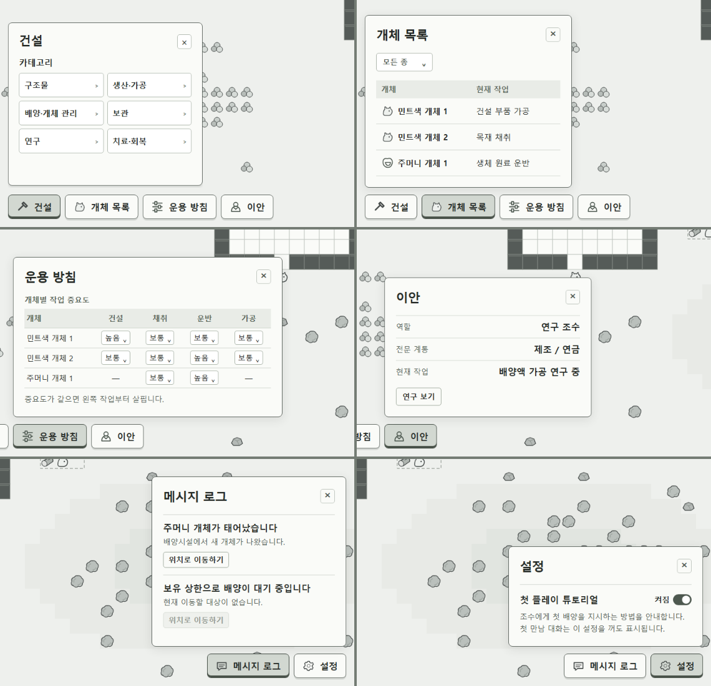
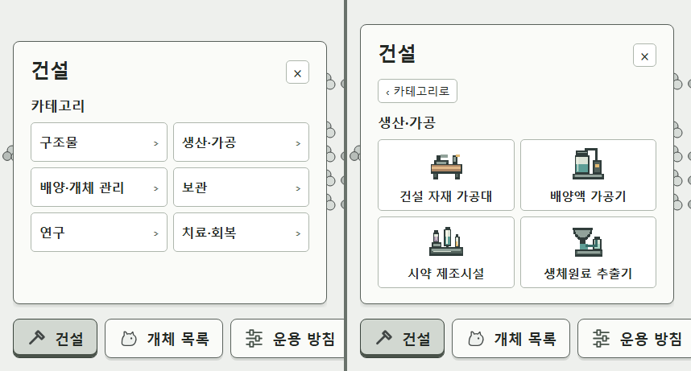

# 첫 프로토타입의 연구소 HUD 와이어프레임

[게임 시작과 결과 화면](session/README.md)에서 부트·타이틀·새 게임 선택 3단계·로딩·클리어·패배의 전체 화면과 전환 동작을 확인할 수 있다.

[기본 HUD 전체 화면](laboratory-hud.png)에서 하단 메뉴를 각각 한 번 눌렀을 때의 화면이다. 여섯 장 모두 같은 카메라 위치에서, 누른 버튼 바로 위에 패널 하나를 여는 배치를 제안한다. 플레이어는 패널 제목과 눌린 버튼을 함께 볼 수 있고, 오른쪽 위 닫기 버튼으로 패널을 닫는다. 기본 HUD 그림의 격자선은 점유 범위를 설명하는 보조선이며 메뉴 시안에서는 실제 플레이처럼 숨겼다.

| 메뉴를 누른 직후의 전체 화면 | 플레이어가 보고 할 수 있는 일 |
| --- | --- |
| [건설](build.png) | 좌측 하단에서 용도별 카테고리를 먼저 고른다. 같은 패널에 그 카테고리에서 현재 지을 수 있는 항목이 나타난다. [카테고리 선택 흐름](#건설-카테고리) |
| [개체 목록](creatures.png) | 좌측 하단에서 현재 운용 중인 개체와 각자 하는 일을 한 줄씩 읽는다. 예를 들어 누가 생체 원료를 운반하는지 알 수 있다. 원하는 개체를 찾는 첫 필터로 종 선택을 제안한다. [개체 비교와 운용 목록](../interface.md#개체-비교와-운용-목록) |
| [운용 방침](policy.png) | 주인공을 선택할 때와 같은 작업표에서 개체별 작업 중요도를 정한다. 시안의 열 순서와 중요도 표기는 예시다. [작업 우선순위 설정](../interface.md#작업-우선순위-설정) |
| [현재 조수의 이름](assistant.png) | 맵에서 조수를 선택할 때와 같은 화면을 연다. 버튼과 패널 제목의 **이안**은 예시 이름이다. 연구 중인 장면에서는 전문 계통과 현재 연구를 보여주는 배치를 제안한다. [조수](../characters.md#조수) |
| [메시지 로그](messages.png) | 우측 하단에서 지난 이벤트를 다시 읽는다. 탄생 기록에서는 **위치로 이동하기**로 개체를 찾을 수 있다. 이전 배양 알림에 연결된 대상이 사라진 예에서는 기록을 읽을 수 있고 이동 버튼은 비활성화된다. [메시지 로그 규칙](../interface.md#메시지-로그) |
| [설정](settings.png) | 우측 하단에서 첫 배양 튜토리얼의 켜짐·꺼짐 상태를 확인하고 전환한다. 첫 만남 대화는 어느 쪽이든 재생되므로 토글 아래에서 그 적용 범위를 알려준다. [첫 플레이 튜토리얼](../interface.md#첫-플레이-튜토리얼) |

패널 배치, 필터 항목, 예시 문구와 개체 번호는 검토용이다. 강제 작업 지시는 맵에서 일할 개체를 선택해 내린다. [작업 우선순위 설정](../interface.md#작업-우선순위-설정)

## 건설 카테고리

[카테고리를 직접 눌러 보는 시안](build-menu.html)에서는 여섯 분류를 열고 **카테고리로** 버튼으로 돌아갈 수 있다. 아래 왼쪽은 건설을 연 순간, 오른쪽은 **생산·가공**을 누른 순간이다. [선택 후 전체 화면](build-production.png)

시설과 구조물은 **건설 → 카테고리 → 세부 항목 → 맵 배치** 순서로 고른다. 첫 건설 때는 생산·가공에서 건설 자재 가공대를 찾을 수 있다. 배양액 가공 연구를 마치면 같은 자리에 배양액 가공기가 추가된다. 자재가 부족해도 해금된 시설은 골라 예약할 수 있다. 위치에 따른 반투명·빨간색 표시는 [건설 배치 미리보기](../../systems/construction.md#건설-배치-미리보기)를 따른다.

아래는 첫 프로토타입의 시설 11종과 실내 지원 장비 3종, 수동으로 배치하는 구조물을 용도별로 묶은 제안이다. 시안은 관련 연구를 모두 마친 시점을 예로 들었다. [시설 목록과 해금 조건](../../../agents/pre-production/direction/scope.md#프로토타입의-시설-확정)

세부 항목에는 플레이어가 맵에 놓을 시설·구조물의 스프라이트와 이름을 함께 표시한다. 시안의 17개 그림은 외형을 구별하기 위한 임시 스프라이트다. 정식 아트가 확정되면 해당 항목의 그림을 교체한다.

| 카테고리 | 세부 항목 |
| --- | --- |
| 구조물 | 바닥, 벽, 문 |
| 생산·가공 | 건설 자재 가공대, 배양액 가공기, 시약 제조시설, 생체원료 추출기 |
| 배양·개체 관리 | 배양시설, 생명체 중계기(가칭), 재활용 시설, 원료 순환기, 배양 촉진기 |
| 보관 | 소형 창고, 중형 창고 |
| 연구 | 기본 연구시설 |
| 치료·회복 | 기본 회복시설, 재생 촉진 장치 |
