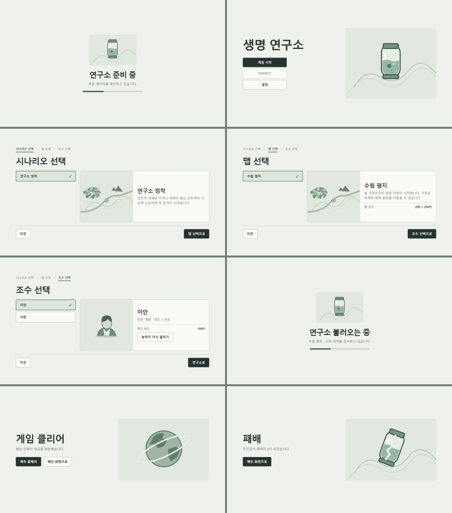

# 게임 시작과 결과 화면

[부트부터 직접 진행하기](session-flow.html) · [본편 시나리오 선택 비교](session-flow.html#full/scenario) · [클리어 화면 열기](session-flow.html#clear) · [패배 화면 열기](session-flow.html#defeat)

**새 게임 흐름**은 부트 → 타이틀의 **게임 시작** → 시나리오 선택 → 맵 선택 → 조수 선택 → 로딩 → 연구소의 첫 만남 대화 순이다. 선택 도중 이전 단계로 돌아가면 이미 고른 항목을 유지하도록 제안한다. 이어하기는 저장된 연구소로 진입한다.

| 전체 화면 | 화면에서 변하는 부분과 플레이어의 다음 행동 |
| --- | --- |
| [부트](boot.png) | 앱을 처음 열면 초기화 상태 표시가 움직인다. 공통 데이터가 준비되면 자동으로 타이틀을 연다. 실패하면 실패 단계와 재시도 동작을 보여준다. |
| [타이틀](title.png) | **게임 시작**은 시나리오 선택을 연다. 저장된 연구소가 있으면 **이어하기**를 사용할 수 있다. 그림은 저장이 없어 버튼이 비활성화된 상태다. |
| [시나리오 선택](scenario.png) | 항목을 고르면 체크 표시와 오른쪽 사건 설명이 함께 바뀐다. 첫 프로토타입에서는 기존 전투력 기준 습격 규칙 한 가지를 확인한다. 본편 예시에서는 **기본**과 **완전 무작위**를 눌러 첫 습격 예고가 언제부터 가능한지 비교할 수 있다. [시나리오와 첫 토벌군](../../../systems/events.md#시나리오와-첫-토벌군) |
| [맵 선택](map.png) | 고른 맵의 지형과 시작 터, 자원 설명을 함께 보여준다. 첫 프로토타입에서는 **수림 평지 250 × 250칸**을 확인한 뒤 **조수 선택으로**를 누른다. [시작 맵](../../../systems/maps.md#시작-맵의-자원과-첫-증설) |
| [조수 선택](assistant.png) | 후보를 누르면 초상·이름·전문 계통·능력치가 해당 조수의 정보로 바뀐다. **능력치 다시 굴리기**는 선택한 조수의 수치를 다시 뽑으며 횟수 제한이 없다. **연구소로**를 누르면 선택을 확정하고 로딩을 시작한다. [조수의 시작 능력치](../../characters.md#조수) |
| [로딩](loading.png) | 준비 중에는 상태 표시가 움직이고 중복 진입 입력을 막는다. 연구소와 세션이 준비되면 새 게임은 첫 만남 대화로, 이어하기는 저장된 진행 단계로 넘어간다. 실패하면 원인을 표시하고 재시도나 안전한 복귀를 안내한다. [씬 전환 지침](../../../../agents/scene-flow.md) |
| [게임 클리어](clear.png) | 본편에서 행성 전체 침공을 완료하고 엔딩을 본 뒤의 화면이다. **계속 플레이**는 같은 연구소 운영으로, **메인 화면으로**는 타이틀로 이어진다. 첫 프로토타입의 연구 도달 목표는 별도로 유지한다. [승리와 엔딩](../../../direction/overview.md) |
| [패배](defeat.png) | 주인공의 체력이 0이 되는 즉시 플레이를 끝내고 패배 이유를 표시한다. **메인 화면으로** 버튼 하나를 누르면 타이틀로 돌아간다. [주인공의 게임오버](../../characters.md#주인공의-게임오버와-조수의-회복) |

세 선택 화면은 타이틀의 새 게임 준비 단계로, 로딩은 전환 중 공용 화면으로, 결과는 연구소 플레이가 끝나는 시점의 화면으로 그렸다. 게임 제목 ‘생명 연구소’, 프로토타입 시나리오명 ‘연구소 정착’, 조수 후보와 수치, 삽화·문구는 시안용이다. 클릭 시안의 부트·로딩은 전환을 체험하도록 대기 시간을 짧게 모사한다. 실제 진입 시점은 준비 완료 여부로 정한다.
