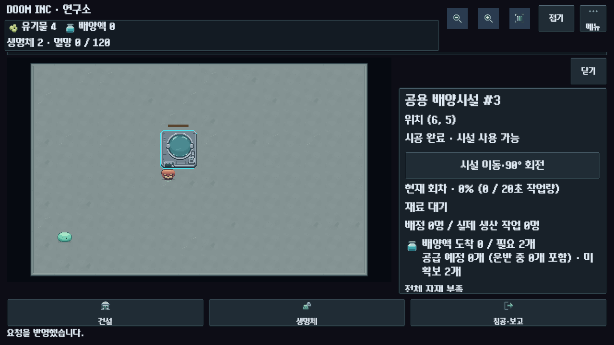
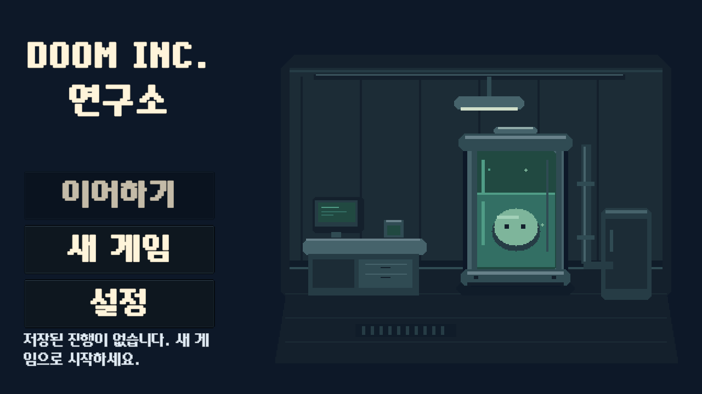

# PLAN-042 정식 아트 통합 검수

2026-11-17: WorldDestruction r002 사용자 원본 확인을 기록하고, PLAN-034·036~041의 승인 아트를 Unity에 일괄 적용했다. **일반 Editor 기술 검증과 실제 적용 화면 사용자 확인을 완료**했다. Unity PLAN-034·036~042와 Art PLAN-011~031은 completed, 두 작업공간 모두 active0개다. [최종 승인 기록](completion.md).

## 적용 및 검증

- 신규 PNG21개, 기존 Fill 재사용을 포함한 대응22행. 침공형/약탈형 r002, 외곽·메뉴·공용 UI·탄생/방출 r001, 타이틀/로딩·군락 점령 r002.
- 원본/출력 픽셀 불일치0, 수령 해시21개 일치. 기존 승인본과 저장/ProjectSettings 보존.
- Edit Mode464개 통과, Play Mode 고유100개 항목 최종 통과. 초기 실패 및 수정 후 재검증은 모두 보존했다.
- 타이틀 큰 글씨 및 스크롤 표시 최초 위치를 수정했다. 글자는 TMP에서 유지한다.
- Android/Player/콘텐츠 빌드·실기기·고부하 검증은 미실행이다. 침공형/약탈형은 현재 이동 AI가 없어 실제 Down Idle을 재생한다.

| 자료 | 내용 |
| --- | --- |
| [최종 manifest](asset-manifest.csv) | Art 원본/리비전·Unity 최종 경로/GUID·승인 상태 |
| [제작 인계](production-handoff.md) / [연결](integration.md) | 7개 PLAN의 적용과 재사용 근거 |
| [49개 완료 기준 대응](plan-verification-matrix.csv) | 각 PLAN의 모든 기준 ↔ 관련 테스트/증거/사용자 최종 승인 |
| [검증 결과](validation.md) / [실제 테스트 집계](final-test-summary.json) | 실행 범위·성공/실패·재검증 |
| [수정 이력](issues.md) / [임시 표현](temporary-art-audit.md) | 발견 문제의 해결·잔여 Temp 유지 근거 |
| [환경 복원](environment.md) | 기존 변경·저장·Editor 설정 보존 |

## 최종 실제 게임 화면

run-005 실제 GameView 캡처. 1280×720 / 720×1280. 화면의 상태·언어 등은 각 PNG 옆 JSON에 기록했다. 전체 조합 전수검사가 아닌 대표 화면이다.

| 화면 | 가로 | 세로 |
| --- | --- | --- |
| 타이틀 | [보기](runs/run-005/screenshots/title-landscape.png) | [보기](runs/run-005/screenshots/title-portrait.png) |
| 로딩 | [보기](runs/run-005/screenshots/loading-landscape.png) | [보기](runs/run-005/screenshots/loading-portrait.png) |
| 연구소/시설 상세 | [보기](runs/run-005/screenshots/laboratory-landscape.png) | [보기](runs/run-005/screenshots/laboratory-portrait.png) |
| 침공형/약탈형 밀집 | [보기](runs/run-005/screenshots/creatures-landscape.png) | [보기](runs/run-005/screenshots/creatures-portrait.png) |
| 설정 팝업 | [보기](runs/run-005/screenshots/popup-landscape.png) | [보기](runs/run-005/screenshots/popup-portrait.png) |
| 군락 점령 진행 | [보기](runs/run-005/screenshots/destruction-landscape.png) | [보기](runs/run-005/screenshots/destruction-portrait.png) |
| 점령 완료/결과 | [보기](runs/run-005/screenshots/results-landscape.png) | [보기](runs/run-005/screenshots/results-portrait.png) |

[탄생 효과](runs/run-005/screenshots/birth-effect.png) · [방출 효과](runs/run-005/screenshots/release-effect.png).
결과 화면의 저장 실패 안내는 **저장 오류/재시도 테스트에서 의도적으로 만든 상태**다. 해결되지 않은 저장 오류를 뜻하지 않는다.

## 사용자 확인 기록

WorldDestruction r002 원본: 2026-11-17 승인.

2026-11-17 사용자: “좋아. 적용된 게임 화면도 확인했어. PLAN-042와 관련 Unity·Art PLAN을 모두 완료 처리해줘. 그리고 main브랜치에 푸쉬해줘”. Unity PLAN-034·036~041과 Art PLAN-011~031의 완료를 기록하고 마지막에 PLAN-042를 completed로 전환했다. [완료 상세](completion.md).
